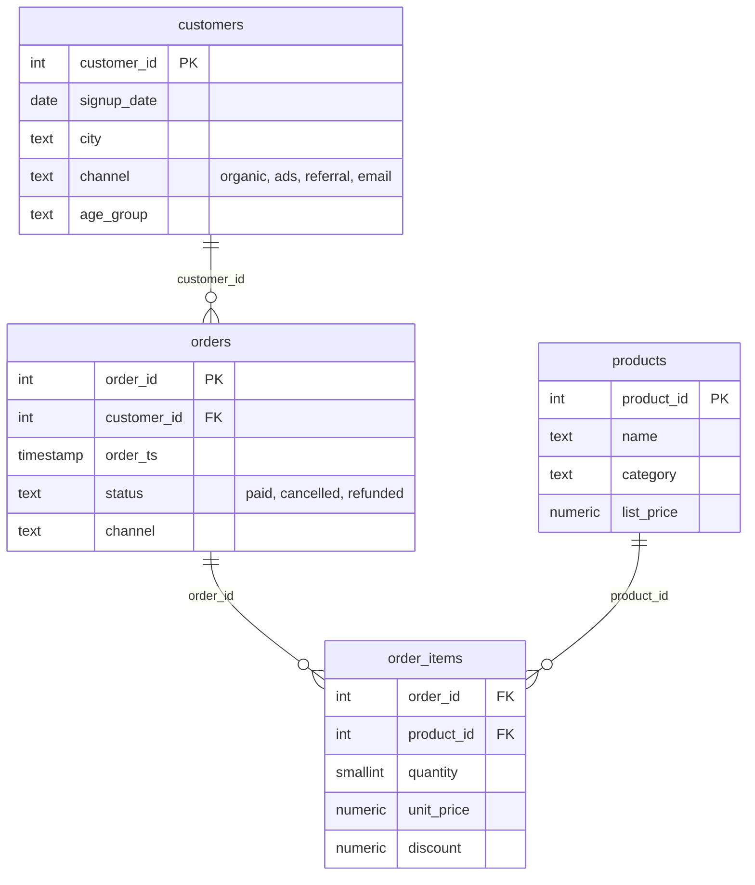

# SQL-кейс: интернет-магазин на PostgreSQL

Учебный кейс по аналитике интернет-магазина: схема из четырёх таблиц, генератор данных и 12 аналитических запросов на PostgreSQL 16 — от выручки по месяцам до когортного удержания, RFM и правила Парето.

Данные синтетические: генератор с фиксированным seed создаёт те же файлы при каждом запуске. Это позволяет показать технику SQL и логику расчёта метрик на воспроизводимом наборе, а не публиковать чужие данные.

## Схема данных



Представление `v_paid_order_totals` считает выручку только по оплаченным заказам: отмены и возвраты в деньги не попадают.

## Данные

| Таблица | Строк | Что внутри |
|---|---:|---|
| `customers` | 8 000 | дата регистрации, город, канал привлечения, возрастная группа |
| `products` | 300 | 8 категорий, цена по прайсу |
| `orders` | 14 073 | дата и время, статус, канал |
| `order_items` | 29 568 | количество, цена продажи, скидка |

Период — январь 2024 — декабрь 2025. Оплаченных заказов 13 052 (92.8 %); отмены — 5 %, возвраты — 2 %. Выручка по оплаченным заказам — 298.5 млн ₽. Покупали хотя бы раз 6 002 клиента из 8 000.

## Как запустить

Нужен Docker (или локальный PostgreSQL 16 и `psql`).

```bash
python3 scripts/generate_data.py     # создаёт data/*.csv
make db                              # поднимает PostgreSQL в Docker
make load                            # создаёт схему и загружает CSV
make queries                         # выполняет все 12 запросов
```

Без Docker: создать базу, затем

```bash
psql -d shop -f sql/schema.sql
psql -d shop -v ON_ERROR_STOP=1 -f sql/load.sql
psql -d shop -f sql/queries/01_monthly_revenue.sql
```

## Запросы и результаты

Все цифры ниже получены на сгенерированном наборе (PostgreSQL 16.2).

### 01. Выручка по месяцам и рост месяц к месяцу

Оконная функция `LAG`, `NULLIF` для первого месяца, средний чек.

| Месяц | Заказы | Выручка, ₽ | MoM, % | Средний чек, ₽ |
|---|---:|---:|---:|---:|
| 2024-01 | 282 | 6 728 823 | — | 23 861 |
| 2024-05 | 423 | 10 518 283 | +31.2 | 24 866 |
| 2024-12 | 707 | 16 020 876 | +20.9 | 22 660 |
| 2025-01 | 477 | 10 650 418 | −33.5 | 22 328 |
| 2025-12 | 964 | 21 446 074 | +17.8 | 22 247 |

Вывод: декабрьский пик и январский провал повторяются оба года — это сезонность, а не разовый всплеск. За два года выручка выросла в 3.2 раза при росте числа заказов в 3.4 раза: средний чек почти не менялся.

### 02. Категории: доля выручки

| Категория | Выручка, ₽ | Заказов | Доля выручки | Выручка на заказ, ₽ |
|---|---:|---:|---:|---:|
| Электроника | 160 488 768 | 5 620 | 53.8 % | 28 557 |
| Дом и кухня | 43 141 364 | 4 255 | 14.5 % | 10 139 |
| Одежда | 39 133 687 | 4 625 | 13.1 % | 8 461 |
| Спорт | 27 507 737 | 2 566 | 9.2 % | 10 720 |
| Игры | 10 391 202 | 1 789 | 3.5 % | 5 808 |
| Красота | 9 733 555 | 2 084 | 3.3 % | 4 671 |
| Зоотовары | 4 758 679 | 1 360 | 1.6 % | 3 499 |
| Книги | 3 318 047 | 1 740 | 1.1 % | 1 907 |

Вывод: половина выручки — одна категория. Одежда обгоняет «Дом и кухню» по числу заказов, но уступает по выручке: чек ниже.

### 03. Когортное удержание

Когорта — месяц первого оплаченного заказа; `m1` и `m3` — доля клиентов, вернувшихся через 1 и 3 месяца.

| Когорта | Клиентов | m1, % | m3, % |
|---|---:|---:|---:|
| 2024-01 | 282 | 14.9 | 12.1 |
| 2024-05 | 267 | 10.9 | 9.7 |
| 2024-09 | 241 | 14.9 | 15.8 |
| 2024-12 | 304 | 9.9 | 11.5 |
| 2025-03 | 265 | 11.3 | 10.6 |
| 2025-07 | 207 | 14.0 | 9.7 |

Вывод: удержание на первом месяце — 10–16 %, к третьему почти не падает. Это значит, что основная потеря происходит сразу после первой покупки, а не постепенно: работать нужно с первым повторным заказом.

### 04. Средний чек и медиана

Средний чек 20.6–24.9 тыс. ₽, медиана 12.5–17.3 тыс. ₽ — среднее выше медианы на 40–50 % из-за крупных заказов электроники (максимум за месяц — до 190 тыс. ₽). Для отчётов о «типичном» чеке корректнее медиана.

### 05. Повторные покупки по каналу привлечения

| Канал | Клиентов | С повторной покупкой | Доля повторных | Заказов на клиента |
|---|---:|---:|---:|---:|
| ads | 1 931 | 1 308 | 67.7 % | 2.46 |
| email | 919 | 575 | 62.6 % | 2.24 |
| referral | 936 | 568 | 60.7 % | 2.16 |
| organic | 2 216 | 1 211 | 54.6 % | 1.91 |

Вывод: платный трафик даёт самую высокую долю повторных покупок. Это не значит, что он «лучше»: в кейсе нет стоимости привлечения, поэтому сравнивать каналы по окупаемости нельзя — только по качеству аудитории.

### 06. RFM-сегментация

`NTILE(5)` по давности, частоте и сумме, затем метки сегментов.

| Сегмент | Клиентов | Доля | Средняя давность, дней | Средняя частота | Пожизненная выручка, ₽ |
|---|---:|---:|---:|---:|---:|
| Середина | 2 144 | 35.7 % | 175 | 2.13 | 49 750 |
| Потерянные | 1 143 | 19.0 % | 412 | 1.02 | 23 134 |
| Ядро | 1 134 | 18.9 % | 44 | 3.63 | 81 428 |
| Новички | 815 | 13.6 % | 45 | 1.03 | 24 002 |
| Спящие лояльные | 766 | 12.8 % | 330 | 3.09 | 69 799 |

Вывод: 19 % клиентов потеряны по давности, ещё 12.8 % — лояльные, но давно не покупавшие. Вместе это треть базы с историей покупок — приоритет для реактивации.

### 07. Правило Парето по товарам

Топ-10 товаров дают 27.0 % выручки, и все десять — из категории «Электроника». Для проверки правила 20/80 нужен отдельный запрос по накопленной доле: `SUM(revenue) OVER (ORDER BY revenue DESC)`.

### 08. Клиенты в зоне риска

Без покупок более 90 дней — 3 821 клиент из 6 002 (63.7 %). Суммарная историческая выручка этих клиентов — 178.2 млн ₽. Высокая доля ожидаема: период в 24 месяца, а покупатели с одним заказом составляют 39 %.

### 09. Срок жизни клиента

| Сегмент | Клиентов | Доля | Средний срок, дней | Заказов на клиента |
|---|---:|---:|---:|---:|
| 1 заказ | 2 340 | 39.0 % | 0 | 1.00 |
| 2+ заказа, больше 180 дней | 2 314 | 38.6 % | 383 | 3.31 |
| 2+ заказа, 31–180 дней | 1 214 | 20.2 % | 104 | 2.29 |
| 2+ заказа, до 30 дней | 134 | 2.2 % | 20 | 2.00 |

Вывод: 39 % покупателей не возвращаются, но те, кто вернулся, остаются надолго — почти 40 % клиентов покупают на горизонте больше полугода.

### 10. Скидки и средний чек

| Скидка в заказе | Заказов | Доля заказов | Выручка, ₽ | Средний чек, ₽ |
|---|---:|---:|---:|---:|
| 0 % | 6 156 | 47.2 % | 119 793 797 | 19 460 |
| 1–10 % | 3 779 | 29.0 % | 116 691 903 | 30 879 |
| 10–20 % | 2 008 | 15.4 % | 44 682 147 | 22 252 |
| 20 %+ | 1 109 | 8.5 % | 17 305 192 | 15 604 |

Вывод: самый высокий чек — в корзинах со скидкой 1–10 %, а не в самых глубоких скидках. Но это не доказательство эффекта скидки: в этой группе больше дорогой электроники. Корректный вывод требует контроля по категории — хороший пример того, почему срез по одному признаку не отвечает на причинный вопрос.

### 11. Статусы заказов по месяцам

Доля оплаченных — 89.5–93.9 %, отмен — 3.4–7.8 %, возвратов — 1.3–2.9 %. Минимум оплаченных — июнь 2024 (89.5 %, отмен 7.8 %). Метрика полезна как контроль качества: если доля отмен растёт, выручка по оплаченным заказам падает даже при росте числа заказов.

### 12. Новые и вернувшиеся клиенты

Доля новых клиентов падает с 100 % в январе 2024 до 32.3 % в декабре 2025: рост всё больше держится на возвратах (653 вернувшихся клиента против 311 новых в последнем месяце). Это здоровый признак, но он же означает, что дальнейший рост требует работы с новой аудиторией.

## Что демонстрирует кейс

- **Оконные функции:** `LAG`, `SUM() OVER`, `NTILE`, `ROW_NUMBER`, накопительные суммы.
- **CTE и многошаговые расчёты:** когорты, RFM, срок жизни.
- **Агрегаты с `FILTER`:** доли по статусам и каналам без подзапросов.
- **Статистические функции:** `PERCENTILE_CONT`, сравнение среднего и медианы.
- **Работа с NULL:** `NULLIF` в расчёте роста.
- **Логика данных:** отделение оплаченных заказов от отмен, учёт скидок, контроль доли отмен.
- **Внимание к интерпретации:** скидки не равны причине роста чека, каналы без CAC нельзя сравнивать по окупаемости.

## Ограничения

- Данные синтетические: закономерности заложены генератором, а не найдены в реальном бизнесе. Ценность кейса — в SQL и методике, не в бизнес-выводах о рынке.
- Нет стоимости привлечения, маржи и данных о показах — поэтому нет CAC, LTV и конверсии воронки.
- Категория «Электроника» доминирует по цене, из-за чего средние и доли смещены; в реальном анализе потребовался бы разрез по категориям.
- Логика RFM зависит от даты среза (`MAX(order_ts)`); при обновлении данных сегменты пересчитываются.
