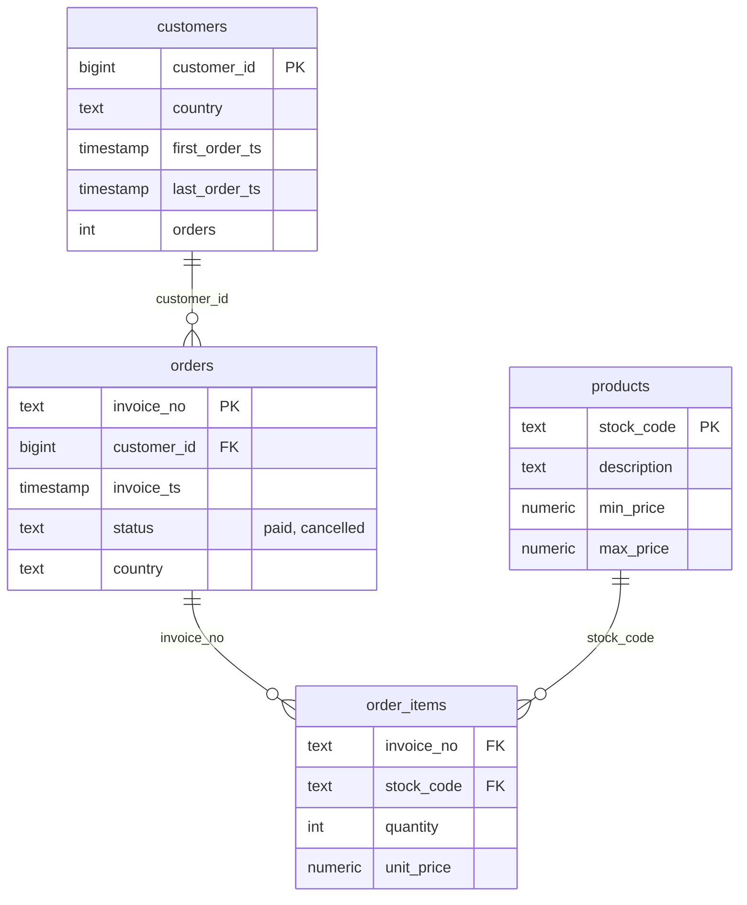

# SQL-кейс: интернет-магазин на PostgreSQL

Аналитика реального датасета розничных продаж: схема из четырёх таблиц, подготовка данных и 12 аналитических запросов на PostgreSQL 16 — от выручки по месяцам до когортного удержания, RFM и правила Парето.

**Данные:** [Online Retail II](https://www.kaggle.com/datasets/mashlyn/online-retail-ii-uci) (Kaggle, лицензия CC0 1.0). Это выгрузка заказов британского оптового продавца подарков и товаров для дома за декабрь 2009 — декабрь 2011: 1 067 371 строка, 43 страны, реальные возвраты, отмены и гостевые заказы.

## Схема данных



Представление `v_paid_order_totals` считает выручку только по оплаченным заказам. Отмены (инвойсы с префиксом `C`) исключены: их отрицательные количества компенсируют исходные продажи.

## Подготовка данных

Исходная таблица содержит не только товары: служебные строки (`POST`, `DOT`, `BANK CHARGES`), нулевые и отрицательные цены, корректировки. Правила очистки зафиксированы в `scripts/prepare_data.py`:

1. оставлены только товарные коды вида `12345` и `12345A` — 1 059 905 строк из 1 067 371;
2. убраны строки с ценой ≤ 0 и нулевым количеством;
3. статус заказа: инвойс с префиксом `C` — отмена, остальные — оплачен;
4. в оплаченных заказах оставлены только положительные количества;
5. одинаковые пары «инвойс + товар» агрегированы: количество суммируется, цена пересчитывается как выручка / количество;
6. заказы без `Customer ID` сохранены (22.6 % строк) — они нужны для выручки, но не участвуют в клиентских метриках.

Итог: **46 907 заказов** (39 513 оплаченных, 7 394 отменённых), **1 008 457 позиций**, **5 874 клиента** с идентификатором, **4 887 товаров**, выручка по оплаченным заказам — **20 047 603 £**.

## Как запустить

Нужен Docker (или локальный PostgreSQL 16 и `psql`), Python 3 и `pandas` для подготовки данных.

```bash
pip install pandas
python3 scripts/download_data.py     # скачивает датасет Kaggle (~15 МБ)
python3 scripts/prepare_data.py      # чистит и раскладывает по CSV
make db                              # поднимает PostgreSQL в Docker
make load                            # создаёт схему и загружает CSV
make queries                         # выполняет все 12 запросов
```

Либо одной командой `make data && make load && make queries`.

Без Docker:

```bash
psql -d shop -f sql/schema.sql
psql -d shop -v ON_ERROR_STOP=1 -f sql/load.sql
psql -d shop -f sql/queries/01_monthly_revenue.sql
```

## Запросы и результаты

Все цифры ниже получены на реальных данных в PostgreSQL 16.2.

### 01. Выручка по месяцам и рост месяц к месяцу

| Месяц | Заказы | Выручка, £ | MoM, % | Средний чек, £ |
|---|---:|---:|---:|---:|
| 2009-12 | 1 666 | 789 010 | — | 474 |
| 2010-11 | 2 718 | 1 432 761 | +30.9 | 527 |
| 2010-12 | 1 549 | 1 185 063 | −17.3 | 765 |
| 2011-01 | 1 080 | 670 830 | −43.4 | 621 |
| 2011-11 | 2 751 | 1 456 671 | +32.0 | 530 |
| 2011-12 | 816 | 614 979 | −57.8 | 754 |

Вывод: выраженная сезонность — пик в ноябре, спад в январе, повторяется оба года. Средний чек в декабре выше обычного: к праздникам растут корзины, а не число заказов. Декабрь 2011 обрезан (данные до 9 декабря), поэтому его сравнивать с полными месяцами нельзя.

### 02. Страны

| Страна | Выручка, £ | Доля выручки | Заказов | Клиентов | Средний чек, £ |
|---|---:|---:|---:|---:|---:|
| United Kingdom | 17 179 279 | 85.7 % | 36 181 | 5 334 | 475 |
| EIRE | 625 298 | 3.1 % | 581 | 3 | 1 076 |
| Netherlands | 549 953 | 2.7 % | 216 | 22 | 2 546 |
| Germany | 387 426 | 1.9 % | 753 | 107 | 515 |
| France | 315 336 | 1.6 % | 598 | 93 | 527 |

Вывод: бизнес почти мононациональный — 86 % выручки в Великобритании. Небольшие страны дают непропорционально высокий средний чек: в Нидерландах 22 клиента приносят 2.7 % выручки, а в Ирландии три клиента — 3.1 %. Это оптовые покупатели, и по ним нельзя считать «рынок»: выборка слишком мала.

### 03. Когортное удержание

| Когорта | Клиентов | m1, % | m3, % |
|---|---:|---:|---:|
| 2010-01 | 368 | 21.5 | 31.5 |
| 2010-03 | 441 | 19.0 | 24.3 |
| 2010-10 | 375 | 25.9 | 12.5 |
| 2010-12 | 76 | 9.2 | 9.2 |
| 2011-05 | 111 | 23.4 | 16.2 |
| 2011-09 | 188 | 27.1 | 14.9 |

Вывод: удержание на первом месяце — 9–27 %, к третьему в среднем 15–30 %. Устойчивого улучшения от когорты к когорте нет: разброс объясняется сезоном и размером когорты (в декабре 2010 всего 76 клиентов). Для надёжных выводов нужен более длинный горизонт и поправка на сезонность.

### 04. Средний чек и медиана

Средний чек — 417–765 £, медиана — 281–350 £. Среднее выше медианы в 1.5–2 раза: распределение скошено оптовыми заказами, максимум достигает 168 тыс. £. Для описания «типичной» покупки корректнее медиана; среднее нужно для выручки и планирования.

### 05. Повторные покупки по странам

| Страна | Клиентов | С повторной покупкой | Доля | Заказов на клиента |
|---|---:|---:|---:|---:|
| United Kingdom | 5 334 | 3 868 | 72.5 % | 6.25 |
| Germany | 107 | 83 | 77.6 % | 7.04 |
| France | 93 | 65 | 69.9 % | 6.34 |
| Switzerland | 22 | 19 | 86.4 % | 3.73 |
| Netherlands | 22 | 15 | 68.2 % | 9.82 |

Вывод: это оптовый бизнес — три четверти клиентов покупают повторно, в среднем 6–10 заказов на клиента. «Новые» клиенты здесь редкость, и метрики удержания нужно читать в этом контексте.

### 06. RFM-сегментация

| Сегмент | Клиентов | Доля | Давность, дней | Заказов | Пожизненная выручка, £ |
|---|---:|---:|---:|---:|---:|
| Середина | 2 079 | 35.5 % | 154 | 4.10 | 1 593 |
| Потерянные | 1 503 | 25.7 % | 457 | 1.25 | 402 |
| Ядро | 1 465 | 25.0 % | 19 | 15.57 | 8 189 |
| Новички | 453 | 7.7 % | 27 | 1.47 | 887 |
| Спящие лояльные | 352 | 6.0 % | 343 | 7.73 | 3 014 |

Вывод: четверть базы — ядро с 15.6 заказами и £8.2 тыс. пожизненной выручки. Ещё четверть потеряна, и 6 % — лояльные, но давно не покупавшие: это главный резерв для реактивации.

### 07. Правило Парето по товарам

Топ-10 товаров дают лишь **8.0 %** выручки, лидер — `REGENCY CAKESTAND 3 TIER` с £344 563 (1.7 %). Классического «20 % товаров дают 80 % выручки» здесь нет: ассортимент широкий, спрос размазан. Это важный вывод для закупок — ставка на несколько хитов не сработает.

### 08. Клиенты в зоне риска

Без покупок более 90 дней — **2 967 клиентов из 5 852 (50.7 %)** с исторической выручкой **£3.37 млн**. Показатель высокий, но ожидаемый: у 27.6 % клиентов всего один заказ, а последняя дата данных — 9 декабря 2011.

### 09. Срок жизни клиента

| Сегмент | Клиентов | Доля | Срок, дней | Заказов |
|---|---:|---:|---:|---:|
| 2+ заказа, больше 180 дней | 3 127 | 53.4 % | 484 | 10.10 |
| 1 заказ | 1 618 | 27.6 % | 0 | 1.00 |
| 2+ заказа, 31–180 дней | 856 | 14.6 % | 98 | 3.28 |
| 2+ заказа, до 30 дней | 251 | 4.3 % | 13 | 2.30 |

Вывод: больше половины клиентов покупают на горизонте более полугода и делают около 10 заказов. Это признак устойчивых оптовых отношений, а не разовых розничных покупок.

### 10. Дни недели

| День | Заказы | Выручка, £ | Средний чек, £ |
|---|---:|---:|---:|
| Понедельник | 6 244 | 3 466 986 | 555 |
| Вторник | 7 147 | 3 957 665 | 554 |
| Среда | 7 115 | 3 474 852 | 488 |
| Четверг | 8 166 | 4 106 405 | 503 |
| Пятница | 5 987 | 3 206 532 | 536 |
| Суббота | 30 | 9 628 | 321 |
| Воскресенье | 4 824 | 1 825 528 | 378 |

Вывод: пик — четверг и вторник. Суббота практически нулевая (30 заказов за два года), воскресенье заметно слабее: это рабочий график оптовика, а не поведение покупателей. Такую аномалию нужно проверять до интерпретации сезонности по дням.

### 11. Отмены по месяцам

Доля отменённых инвойсов — 12.6–20.5 %, в деньгах это от −£7 тыс. до −£174 тыс. в месяц. Пики возвратов: январь 2011 (−£91.5 тыс.) и декабрь 2011 (−£174 тыс., обрезанный месяц). Отмены — существенная часть бизнеса: если считать выручку по всем инвойсам, она завышается на 3–4 %.

### 12. Новые и вернувшиеся клиенты

Доля новых клиентов падает со 100 % в декабре 2009 до 10–18 % в 2011 году. В ноябре 2011 из 2 642 заказов 191 сделали новые клиенты и 1 469 — вернувшиеся. Рост держится на существующей базе, а привлечение новых замедлилось — это ключевой риск для оптовика.

## Что демонстрирует кейс

- **Оконные функции:** `LAG`, `SUM() OVER`, `NTILE`, `ROW_NUMBER`, накопительные суммы.
- **CTE и многошаговые расчёты:** когорты, RFM, срок жизни.
- **Агрегаты с `FILTER`:** доли по статусам и странам без подзапросов.
- **Статистические функции:** `PERCENTILE_CONT`, сравнение среднего и медианы.
- **Работа с NULL:** гостевые заказы без `Customer ID` не ломают клиентские метрики.
- **Логика данных:** отмены и возвраты отделены от продаж, служебные строки отфильтрованы, агрегация дублей заказа.
- **Внимание к интерпретации:** субботняя аномалия, обрезанный декабрь 2011 и микровыборки по странам не превращаются в «инсайты».

## Ограничения

- Данные одного британского оптовика за 2009–2011 годы; выводы не переносятся на другой бизнес.
- Декабрь 2011 обрезан (9 дней) — сравнения с полными месяцами некорректны.
- 22.6 % строк — гостевые заказы без идентификатора клиента: клиентские метрики покрывают только 5 874 клиента.
- Нет себестоимости и маржи: считаем выручку, а не прибыль.
- Нет данных о рекламе и каналах привлечения: нельзя посчитать CAC и окупаемость.
- Суббота почти без заказов — вероятно, особенность учёта, а не спроса.

## Лицензия

Код и материалы — [MIT](LICENSE). Данные принадлежат источнику: [Online Retail II](https://www.kaggle.com/datasets/mashlyn/online-retail-ii-uci) — CC0 1.0 (Kaggle).
